# qchat

An open-source, end-to-end-encrypted, post-quantum-hybrid terminal chat written in Go.

> **Warning: unaudited software.** qchat has not been reviewed by an independent security auditor. Do not use it for anything sensitive until an independent audit has been completed and published. The 1:1 session protocol (a KEM-based handshake and double ratchet), the group protocol (sender keys) and the sealed-sender construction are composed from standard primitives but are **not independently analysed**. Read [SECURITY.md](SECURITY.md) for exactly what is and is not protected.

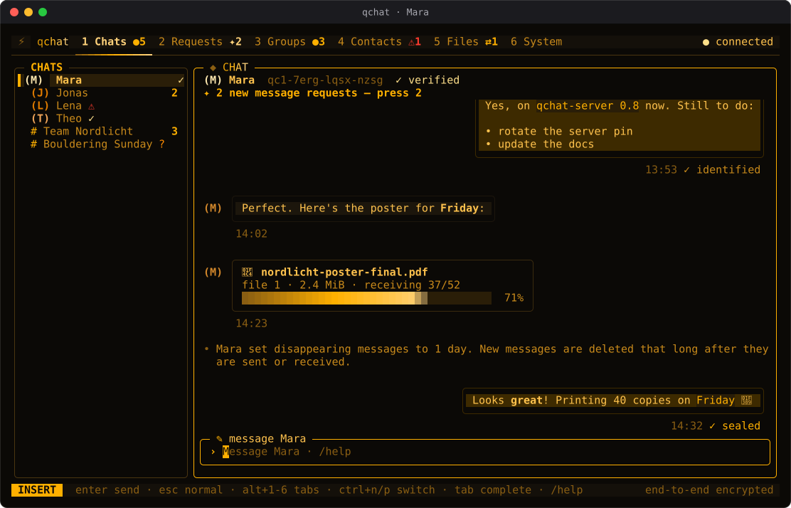

More screens are in [Screenshots](#screenshots).

## Overview

qchat consists of two binaries:

- `qchat-server`: a relay server (Linux and Windows).
- `qchat`: a terminal client built with Bubble Tea v2 and Lip Gloss v2.

The relay stores and forwards ciphertext. A server operator can build clients that have the server address and the server public-key fingerprint embedded, so users connect only to that pinned server.

## Features

### Transport

- TLS 1.3 restricted to the hybrid key exchange X25519MLKEM768
- Server certificate pinning by SPKI SHA-256; no public CA trust
- Versioned CBOR wire frames with strict, canonical-only decoding
- Connection limits and per-session rate limits enforced by the relay; the relay never logs client IP addresses

### Identities

- Hybrid identity signatures: Ed25519 and ML-DSA-65, both required
- Self-authenticating IDs (`qc1-...`) and self-signed key bundles
- Safety numbers (60 digits) with terminal QR codes and key-change warnings
- Passphrase-protected profile (Argon2id, XChaCha20-Poly1305) and an encrypted local database
- Registration with invite codes by default

### Messaging and forward secrecy

- Signed hybrid prekeys (MLKEM768-X25519), rotated and topped up automatically
- KEM-based asynchronous session start inspired by PQXDH, with a signed, timestamped and replay-checked Init
- Per-direction hybrid KEM double ratchet: forward secrecy and post-compromise security
- Offline delivery: the relay stores only ciphertext until the recipient acknowledges it (default TTL 7 days)
- Send results do not reveal whether a recipient is online

### Groups

- Up to 256 members with admins: `/group create|add|remove|admin|unadmin|rename|leave|accept|members`
- Sender keys with hybrid-signed messages and encrypted headers
- Key rotation by every remaining member on removal, after 1000 messages or 7 days
- Verified join history for new members and out-of-sync detection
- Relay fan-out with `SendMulti`: the payload is stored once, partial delivery is reported

### Metadata protection

- **Sealed sender:** messages are sent over a separate anonymous connection and the sender ID travels only inside the end-to-end encrypted payload, so the relay does not store who sent a message. Senders prove permission with a per-user access key that contacts receive over the encrypted channel. The first message to a new contact is sent identified; after the key exchange there is never an automatic fallback to identified sending. Bundles and prekeys of such contacts are fetched over the anonymous connection, and the sealed content is padded to 32 KiB or more
- **Padding:** plaintexts are padded inside the encryption to size buckets from 512 B to 256 KiB, so the relay sees the bucket and not the exact length
- **Tor:** `--tor` (or `--socks5 HOST:PORT`) sends every client connection through a SOCKS5 proxy with no local name resolution and a separate circuit per session; the relay can run as an onion service. Tor is optional and is not a dependency of either binary

These measures reduce what the relay learns; they do not make traffic analysis impossible. See [SECURITY.md](SECURITY.md).

### Files and disappearing messages

- Encrypted file transfer with `/send`: files are split into 48 KiB chunks, each chunk is encrypted with XChaCha20-Poly1305 under a per-file key, and the chunks travel inside the end-to-end encrypted layer. The maximum size is 64 MiB
- Received files are stored encrypted at rest; `/save` lists the files of the conversation and `/save <n> [dir]` writes the plaintext of one of them where you ask, never overwriting an existing file
- Disappearing messages with `/timer`: the interval is set per conversation and agreed in-band between the participants; a sweeper deletes expired messages from the local database

Deletion is local and best effort. A contact can keep, copy or photograph what you send. See [SECURITY.md](SECURITY.md).

### Terminal UI

- Five themes (`dusk`, `fjord`, `ember`, `contrast`, `paper`) selected with `/theme <name>` and stored in the encrypted local database
- Markdown in messages (`/markdown on|off`): emphasis, code, lists and block quotes only; links are shown as text with the address in brackets and are never clickable, images appear as `[image: alt]`, HTML is shown as typed
- Local history search: `/search <text>` and `/search all <text>`. History is encrypted at rest without a plaintext index, so search decrypts and scans the 2000 most recent messages of each conversation
- `/help` overlay listing every command by topic
- No typing indicators, by design: they would tell the relay in real time when and to whom you are writing

### Installers and releases

- `qchat-server build-client` builds pinned, reproducible clients for Linux, Windows and macOS (amd64 and arm64) and writes `SHA256SUMS`
- Inno Setup installer for Windows, `.deb`/`.rpm` packages, and notes for macOS signing and notarization
- Tagged releases are built by GoReleaser; the checksum file carries a keyless cosign signature

## Architecture

```
                      Tor (optional, SOCKS5)
                     .---------------------.
                     |                     |
+----------+  authenticated connection     v                +----------------+
|  qchat   | ===== WebSocket over TLS 1.3 =====>            |  qchat-server  |
|  client  |   (X25519MLKEM768 only, SPKI pinned)           |     relay      |
|   TUI    | ===== anonymous connection (sealed sends) ==>  |                |
+----------+                                                +----------------+
     |                                                              |
     v                                                              v
 encrypted SQLite:                                  SQLite: identity bundles, prekeys,
 messages, keys, files,                             access verifiers, invite hashes,
 settings                                           undelivered ciphertext
```

Frames on the wire are versioned CBOR messages. Message content is padded and encrypted end to end before it reaches the relay, so the relay only handles ciphertext of bucketed size.

Cryptographic building blocks (established libraries only): Go standard library (`crypto/tls`, `crypto/hpke`, `crypto/mldsa`, `crypto/ed25519`, `crypto/hkdf`, `crypto/hmac`), `golang.org/x/crypto` (XChaCha20-Poly1305, ChaCha20-Poly1305, Argon2id) and `modernc.org/sqlite` (no CGO). Details in [SECURITY.md](SECURITY.md) and [docs/design](docs/design).

## Build

Requires Go 1.27.3 or newer.

```sh
go build -o qchat-server ./cmd/server
go build -o qchat ./cmd/client
```

Released binaries, packages and installers are listed on the GitHub releases page; see [Verifying a release](packaging/README.md#verifying-a-release).

## Quick start

Initialise and run a server (default port 7443):

```sh
qchat-server init --data-dir ./data --host chat.example.org
qchat-server run --config ./data/server.toml
qchat-server fingerprint --data-dir ./data
```

Registration requires an invite code by default (`registration = "invite"` in `server.toml`). Create one per user; it is shown only once:

```sh
qchat-server invite create --config ./data/server.toml --uses 1 --ttl 72h
```

Connect a client using the fingerprint printed by `init`. On first start the client creates a profile (display name and a passphrase of at least 12 characters):

```sh
qchat --server chat.example.org:7443 --pin sha256:<hex> --invite <CODE>
```

Then, inside the client:

- `/whoami` shows your ID (`qc1-...`) and a QR code; share it with your contact over a channel you trust.
- `/add <qc1-id> <name>` adds a contact; type to send end-to-end encrypted messages.
- `/verify` shows the 60-digit safety number and QR code; compare it with your contact and press `v`.
- `/group create <name>` creates a group; `/group add` and the other `/group` subcommands manage it.
- `/send <path>` sends an encrypted file to the open conversation; `/save` lists received files and `/save <n> [dir]` saves one.
- `/timer off|30s|5m|1h|1d|1w` sets disappearing messages for the open conversation; `/timer` alone shows the current setting.
- `/help` lists every command.

To send all connections through Tor (default SOCKS port `127.0.0.1:9050`), add `--tor`; use `--socks5 HOST:PORT` for another proxy such as Tor Browser at `127.0.0.1:9150`:

```sh
qchat --server <onion-address>.onion:7443 --pin sha256:<hex> --tor
```

There is no fallback: if the proxy is unavailable, the client does not connect.

Messages to offline contacts are stored by the relay as ciphertext until the recipient comes online and acknowledges them (default up to 7 days).

## Deployment

- Linux: [`deploy/systemd`](deploy/systemd/README.md), with a hardened unit in [`deploy/systemd/qchat-server.service`](deploy/systemd/qchat-server.service)
- Windows service: [`deploy/windows`](deploy/windows/README.md)
- Tor onion service: [`deploy/tor`](deploy/tor/README.md). The server has no Tor code; tor forwards to a loopback listener, and the per-IP connection and sealed-recipient limits must be raised because every onion connection arrives from `127.0.0.1`
- Packages and installers: [`packaging`](packaging/README.md)

## Pinned client installers

An operator builds clients that carry the server address and public-key fingerprint. A pinned client connects only to that server and rejects different `--server` or `--pin` values:

```sh
qchat-server build-client --config /etc/qchat/server.toml --server chat.example.org:7443 --version v0.8.0 --out ./qchat-clients
```

`build-client` reads only `server.toml` and the certificate, never the private key. Builds are reproducible (`CGO_ENABLED=0`, `-trimpath`, `-buildvcs=false`, empty build ID), so a second person can rebuild with the same inputs and compare `SHA256SUMS`. [`packaging/README.md`](packaging/README.md) covers the Windows installer, Linux packages, Authenticode and Developer ID signing, and verifying release checksums and cosign signatures.

## Security

qchat uses hybrid post-quantum constructions throughout and no home-grown primitives, but it is unaudited and has known limits. In short:

- The relay cannot read message content, file contents, group names or private keys.
- The relay still sees recipient IDs, timing, size buckets and, for groups, the recipient list. Sealed sender hides the sender from stored data, but without Tor the relay can link the anonymous and authenticated connections by address.
- An endpoint compromised while the application is unlocked, a weak passphrase, or an unverified safety number defeats the protections.
- The relay's TLS certificate key is still a classical Ed25519 key.

The full threat model, the complete list of what is not protected and how to report vulnerabilities are in [SECURITY.md](SECURITY.md). Contribution rules are in [CONTRIBUTING.md](CONTRIBUTING.md); changes are tracked in [CHANGELOG.md](CHANGELOG.md).

## Roadmap

| Phase | Scope | Version | Status |
|-------|-------|---------|--------|
| 1 | Repository, skeleton, pinned TLS 1.3 server/client connection, simple TUI | v0.1.0 | Done |
| 2 | Identities, hybrid keys, 1:1 end-to-end messages | v0.2.0 | Done |
| 3 | Forward secrecy (ratchet), prekeys, offline delivery | v0.3.0 | Done |
| 4 | Groups, including key rotation | v0.4.0 | Done |
| 5 | Metadata protection: padding, sealed sender, Tor | v0.5.0 | Done |
| 6 | Pinned client installer builder, packaging, signed releases | v0.6.0 | Done |
| 7 | TUI polish, themes, Markdown, search, encrypted files, disappearing messages | v0.7.0 | Done |
| 8 | Hardening, fuzzing, CI, documentation, release pipeline | v0.8.0 | Done |
| Next | Independent security audit | - | Not started |

An independent audit is the next step. Until it is complete and published, treat qchat as experimental.

## Screenshots

All names, IDs, groups and messages in these images are made up. They are rendered from the real interface by [`tools/screenshots`](tools/screenshots); see [docs/screenshots](docs/screenshots/README.md) to regenerate them.

| | |
|---|---|
| 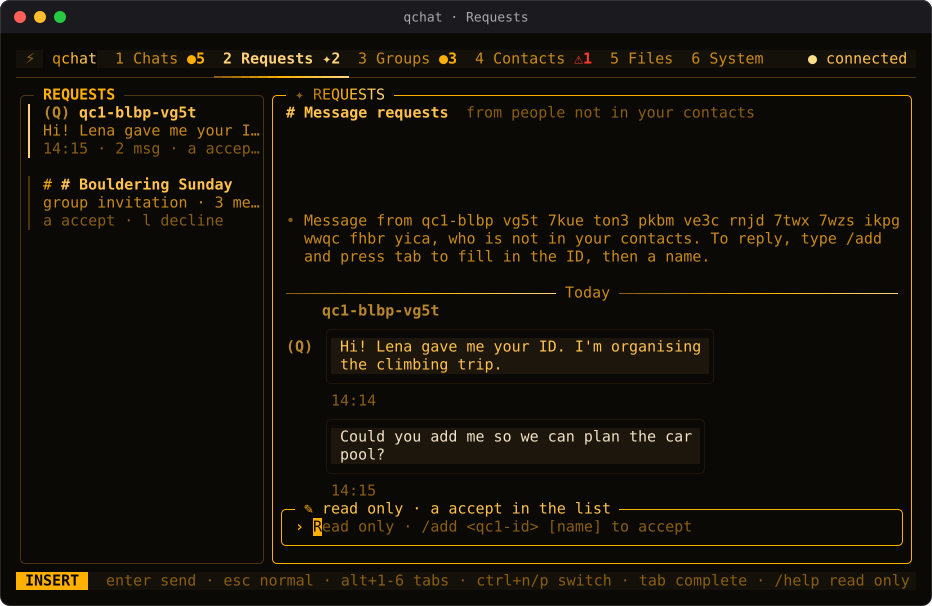 | 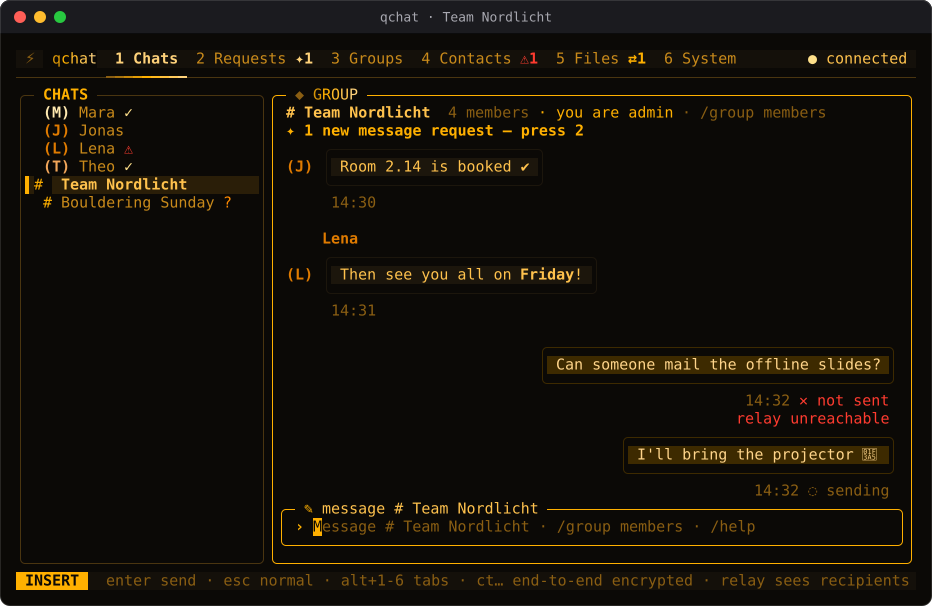 |
| **Requests**: a message request from someone who is not a contact, and a group invitation, as cards you accept or decline. | **Groups**: several senders, a failed message with its reason and a message still sending. |
| 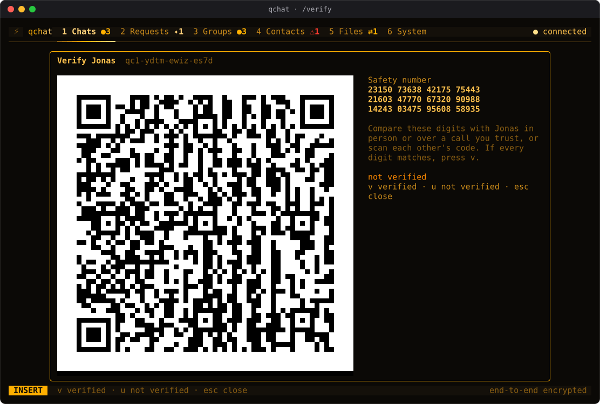 | 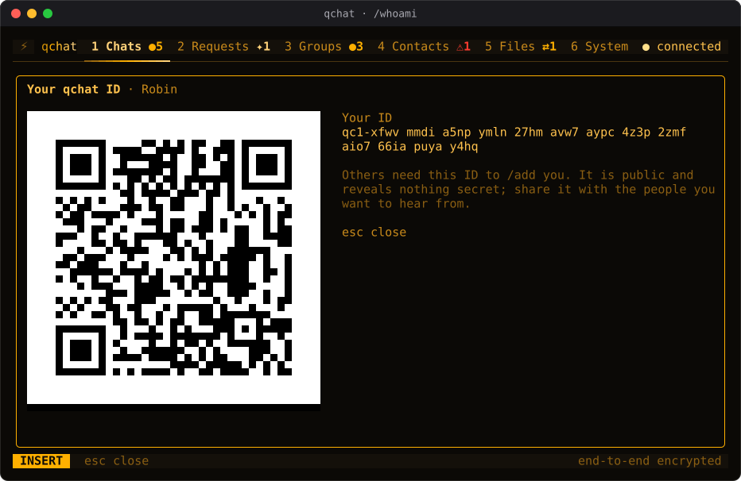 |
| **`/verify`**: the 60-digit safety number and a QR code to compare with a contact. | **`/whoami`**: your ID and its QR code, to share with people who want to add you. |
| 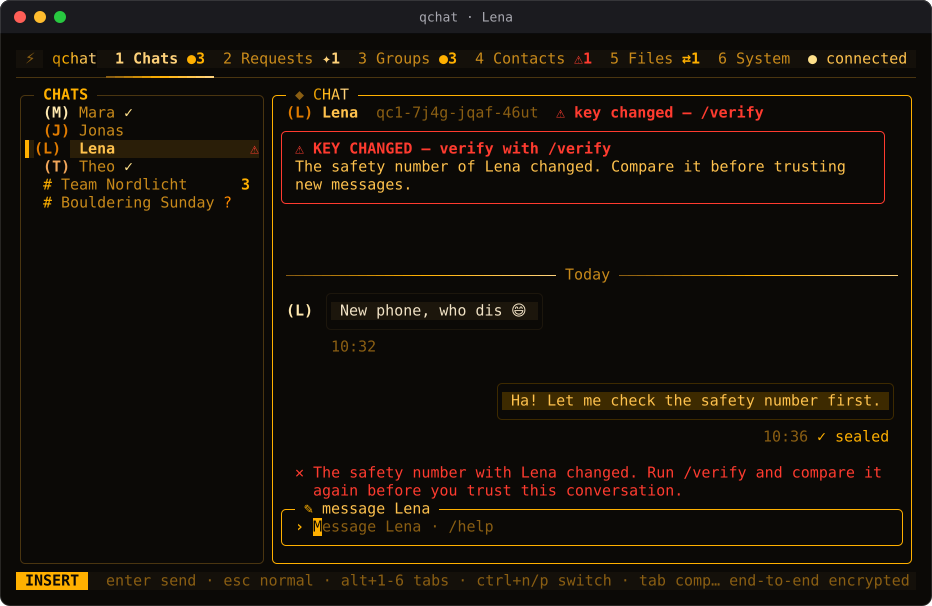 | 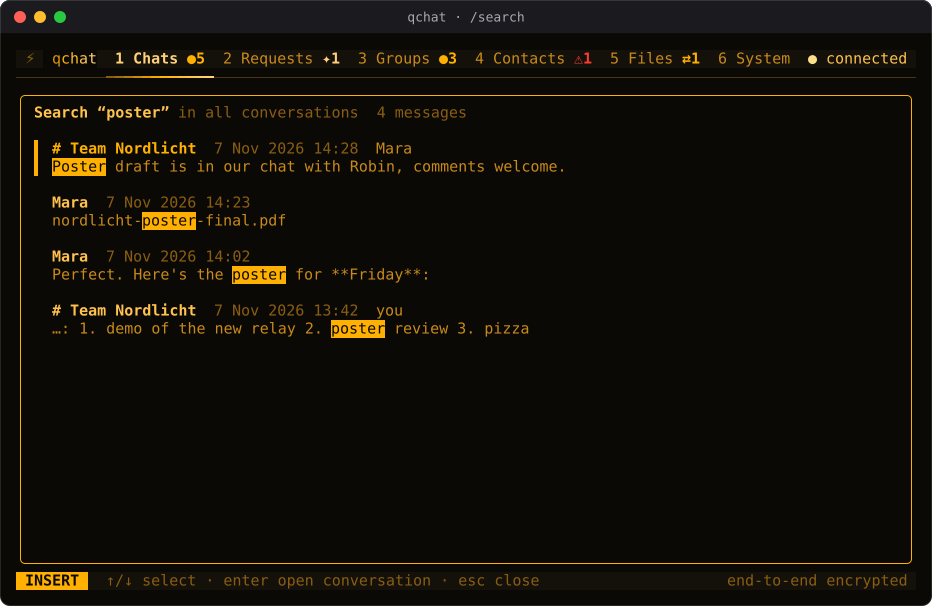 |
| **Key change**: a contact's identity key changed; the banner stays until you compare safety numbers again. | **`/search`**: find messages in one conversation or in all of them. |
| 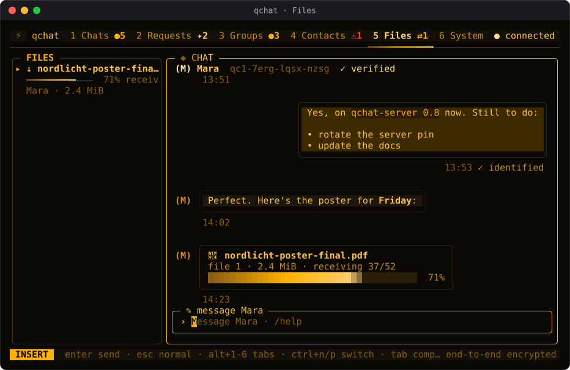 | 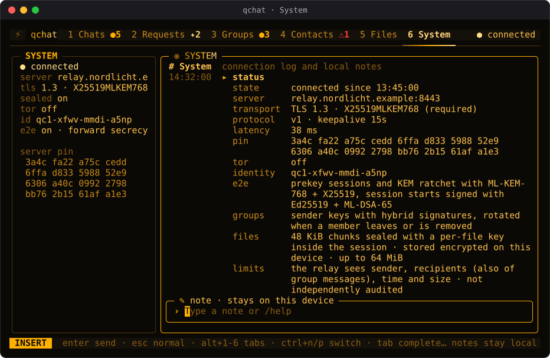 |
| **Files**: transfers with progress, next to the conversation they belong to. | **System**: the connection log and `/status`, including what the relay can see. |
| 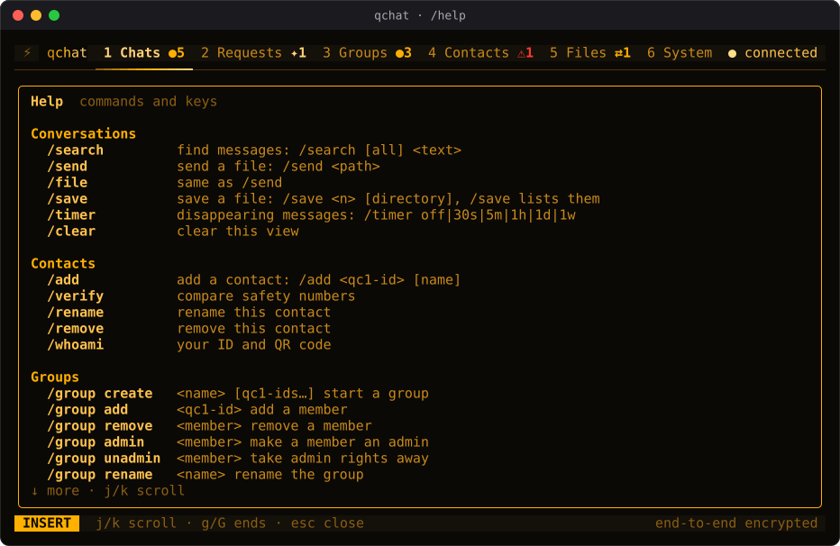 | 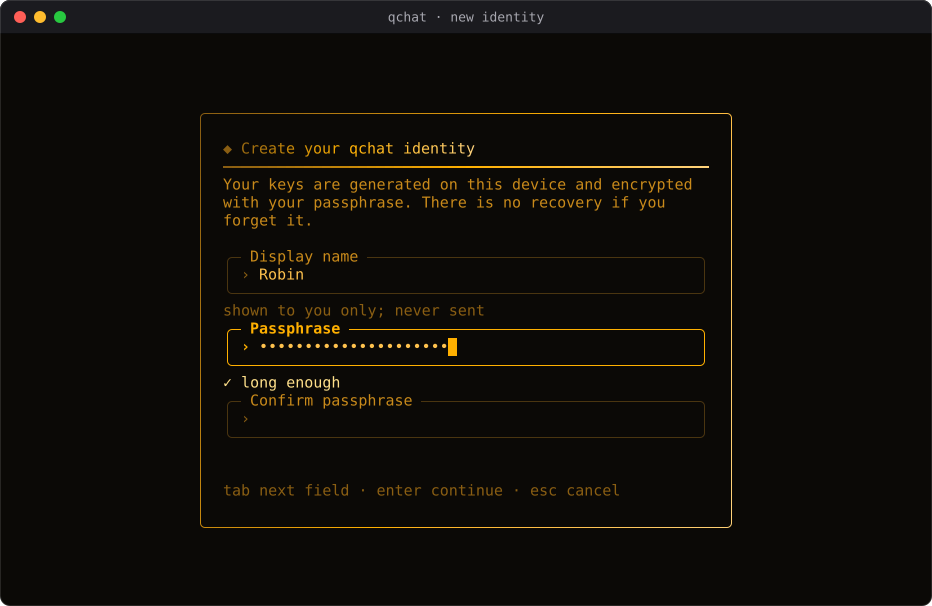 |
| **`/help`**: every command and key. | **First run**: create an identity protected by a passphrase. |
| 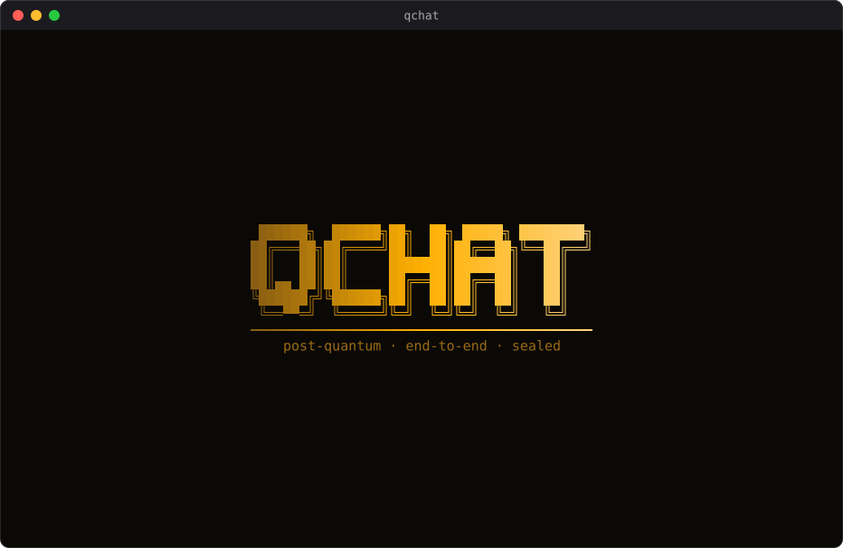 | |
| **Start screen**: shown briefly at launch; `/animations off` turns it off. | |

### Themes

The same conversation in four of the built-in themes (`/theme` lists all of them):

| | |
|---|---|
| 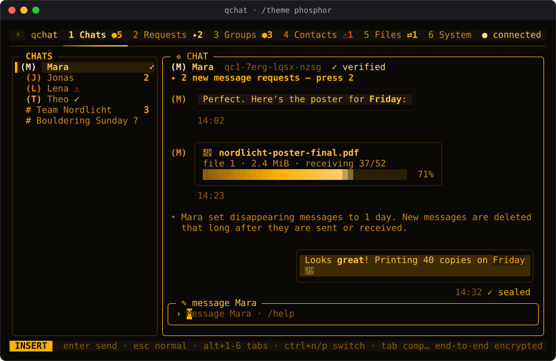 | 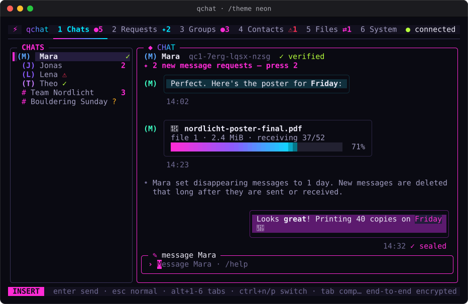 |
| **phosphor** (default) | **neon** |
| 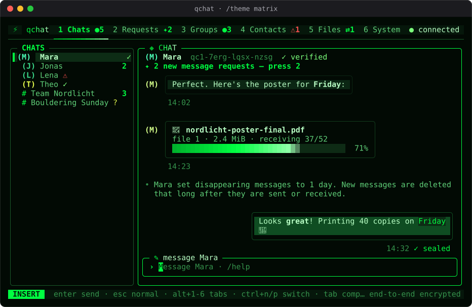 | 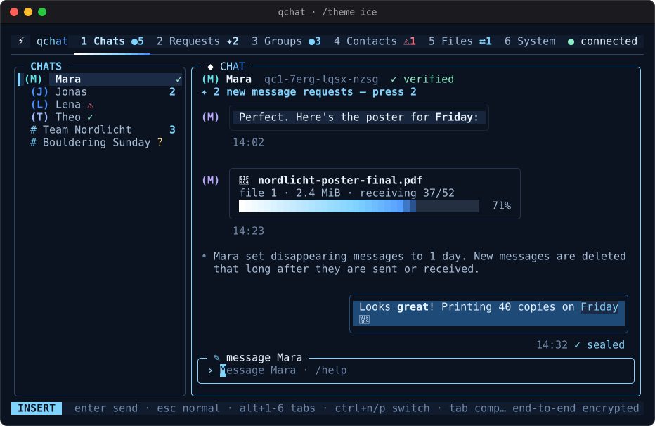 |
| **matrix** | **ice** |

## License

qchat is licensed under the GNU Affero General Public License v3.0. See [LICENSE](LICENSE).
